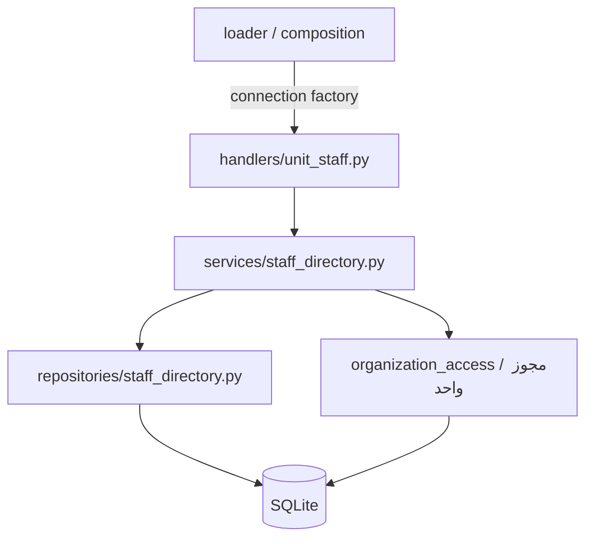

# اصلاح معماری ربات ERP

هدف: تبدیل تدریجی ربات به بخش‌های مستقل و قابل آزمون، با حفظ رفتارهای
تأییدشده، گردش مرخصی، شناسه پرسنل و مجوزهای قدیمی.

وضعیت فعلی: گام هجدهم (آزمون کپی محلی و نامزد انتشار نسخه اصلاح‌شده)؛ ۸۵۳ تست موفق‌اند.
هر ۱۷۳ هندلر در نوزده Router مستقل ثبت می‌شوند؛ هندلر فعال قدیمی باقی نمانده است.

## مبنای بررسی

- مخزن اصلی: `https://github.com/imsheva7/tarmitabot`، شاخه `main`.
- نسخه خوانده‌شده: `8203a423a1433a600ab9ecb1cb06d37879e8fa6a`.
- نسخه GitHub در زمان بررسی، `bot.py` یکپارچه با ۱۳۷ هندلر و
  `Procfile` با دستور `worker: python bot.py` داشت.
- نسخه محلی شامل ۱۷۳ هندلر، خدمات سازمانی، اصلاحات مرخصی و تست‌های جدید است.
  تفاوت نسخه محلی و GitHub صرفاً تغییر معماری نیست و پیش از ادغام باید
  تغییرات رفتاری و مهاجرت دیتابیس جداگانه بررسی شوند.
- کپی مخزن در `deployment-source/tarmitabot` فقط برای بررسی دریافت شده؛
  هیچ commit، push، PR یا استقراری در این مرحله انجام نشده است.

## گام اول انجام‌شده: مشاهده پرسنل واحد

- `handlers/unit_staff.py`: Router مستقل با import صریح؛ دریافت پیام، بررسی
  قالب callback، ساخت دکمه و نمایش پاسخ. اتصال دیتابیس هنگام ساخت Router
  به آن داده می‌شود و ماژول به `runtime` وابسته نیست.
- `services/staff_directory.py`: تشخیص کاربر فعال، فیلتر واحدهای مجاز و
  بررسی مجدد مجوز قبل از خواندن اعضا؛ نتیجه مستقل از اشیای تلگرام است.
- `repositories/staff_directory.py`: SQL خواندن شناسه پرسنلی، واحدها و اعضای
  فعال. این لایه مالک اتصال یا تراکنش نیست و مجوز صادر نمی‌کند.
- توابع قدیمی خواندن عضویت در `organization_memberships.py` حفظ شده‌اند
  و به repository جدید ارجاع می‌دهند تا SQL تکرار نشود.
- سه هندلر از `024_admin.py` خارج شده‌اند. شمار کل همچنان ۱۷۱ است:
  ۱۶۸ هندلر قدیمی و سه هندلر Router جدید.
- Router جدید از تزریق نام در loader استفاده نمی‌کند. ۲۶ ماژول قدیمی
  هنوز به روش قبلی بارگذاری می‌شوند؛ حذف کامل آن سازوکار مراحل بعدی است.
- middleware قدیمی کنترل حساب فعال روی Router جدید هم اعمال می‌شود.

## اعتبارسنجی این گام

۱۴۰ تست خودکار موفق شدند. آزمون Dispatcher واقعی aiogram پس از انتقال
هندلرها، نمایش واحد، نمایش اعضا، بازگشت، لغو مجوز و اعمال middleware
حساب غیرفعال را بررسی می‌کند. تست‌های سرویس و repository بدون BOT_TOKEN
و بدون ایجاد دیتابیس، کلید یا شیء Bot قابل import هستند؛ ساخت Router نیز
به runtime، شبکه یا اتصال دیتابیس نیاز ندارد.

دو تست قدیمی که به متن دقیق SQL در هندلر وابسته بودند، با بررسی مرز
لایه‌ها جایگزین شدند. تست‌های رفتاری دسترسی و لغو مجوز حفظ شده‌اند و
اکنون توابع Router واقعی را اجرا می‌کنند، نه نسخه استخراج‌شده با AST.

آزمون زنده قبلی فاز ۵B مربوط به قبل از این بازآرایی است؛ برای نسخه جدید
آزمون خودکار اجرا شده و آزمون زنده دوباره هنوز انجام نشده است.

پشتیبان سورس و تست‌های قبل از بازآرایی:
`backups/architecture_before_staff_directory.zip`.
دیتابیس اصلی، کلید رمزنگاری و سرویس Railway تغییر نکرده‌اند.

## ادامه مسیر

۱. بررسی سازگاری و کارایی نسخه یکپارچه‌شده روی کپی دیتابیس واقعی؛ Routerها
   اکنون مستقل ثبت می‌شوند و تزریق namespace و بارگذاری ماژول‌های قدیمی حذف شده‌اند.
۲. مقایسه با نسخه اصلی، آزمون مهاجرت روی کپی دیتابیس واقعی، آزمون زنده
   نسخه بازآرایی‌شده و سپس آماده‌سازی انتشار با پشتیبان و مسیر بازگشت.

پیش از انتشار، مسیر واقعی دیتابیس و کلید در Railway و وجود Volume باید
مشخص شود. وضعیت فعلی Volume از طرف کاربر نامشخص اعلام شده است.

## گام دوم انجام‌شده: تنظیمات و اتصال دیتابیس

- `core/settings.py`: شیء تنظیمات تغییرناپذیر با بارگذاری صریح محیط؛ بدون
  نیاز به توکن برای استفاده مستقل. مسیرها، نام متغیرهای محیطی و مقدارهای
  پیش‌فرض قبلی حفظ شده‌اند. توکن و کلید در نمایش متنی شیء پنهان می‌مانند.
- اعتبارسنجی `GROUP_ID` و شناسه راه‌اندازی مدیر، نام تنظیم معیوب را اعلام
  می‌کند و مقدار آن را در پیام خطا چاپ نمی‌کند.
- `core/database.py`: مدیریت مستقل اتصال SQLite؛ همان sqlite3.Row،
  foreign key فعال و timeout ده‌ثانیه‌ای. موفقیت commit و خطا یا وقفه
  rollback می‌شود و اتصال در پایان بسته می‌شود.
- `runtime.get_connection()` به لایه جدید ارجاع می‌دهد و همچنان `DB_PATH`
  را در زمان هر فراخوانی می‌خواند؛ ابزار آزمایش و هندلرهای قبلی سازگارند.
- تنظیم seed پرسنل و راه‌اندازی مدیر همراه سایر تنظیمات یک‌بار در
  راه‌اندازی صریح خوانده می‌شوند. تغییر آن‌ها در محیط نیازمند
  راه‌اندازی مجدد ربات است؛ `init_db()` دیگر محیط را دوباره نمی‌خواند.
- بررسی نبود کلید برای دیتابیس موجود از مسیر دیتابیس در تنظیمات استفاده
  می‌کند؛ دیتابیس و کلید فعلی تغییر داده نشده‌اند.

اعتبارسنجی: ۱۵۷ تست موفق، شامل ۱۷ تست جدید برای تنظیمات، نشت‌نکردن مقادیر
حساس در نمایش و پیام خطا، بارگذاری بدون فایل/توکن، commit، rollback هنگام
خطا و وقفه، foreign key، بسته‌شدن اتصال و جدایی دو دیتابیس. تست یکپارچه
Router واقعی و تست‌های مرخصی هم موفق‌اند.

پشتیبان این مرحله: `backups/architecture_before_settings_database.zip`.
در پایان گام دوم، ایجاد Bot، بارگذاری کلید و تنظیم logging هنوز هنگام
import runtime انجام می‌شدند. این محدودیت در گام سوم زیر برطرف شده است.

## گام سوم انجام‌شده: راه‌اندازی صریح و رمزنگاری

- `bootstrap.py` مالک ساخت منابع برنامه است. `create_application(settings)`
  توکن را بررسی و کلید، Bot و Dispatcher را فقط با فراخوانی صریح آماده
  می‌کند. این تابع دیتابیس را باز نمی‌کند و polling یا scheduler شروع نمی‌کند.
- `initialize_runtime(settings=None)` منابع را به نمای سازگاری runtime متصل
  و middleware قبلی را روی Dispatcher نصب می‌کند. فراخوانی تکراری همان
  برنامه را بازمی‌گرداند؛ تغییر تنظیمات یا استفاده دوباره پس از بسته‌شدن
  نیازمند شروع فرایند جدید است تا importهای قدیمی منابع ناسازگار نگیرند.
- import کردن `runtime`، `erpbot.main`، `main` و `loader` بدون BOT_TOKEN
  ممکن است. در این مرحله Bot، Dispatcher، کلید، دیتابیس و فایل log ساخته
  نمی‌شوند و تنظیمات محیط نیز تا راه‌اندازی صریح اعتبارسنجی نمی‌شوند.
- `core/encryption.py` خواندن کلید و تبدیل متن را جدا می‌کند. ترتیب اولویت
  قبلی حفظ شده است: FERNET_KEY، فایل کلید موجود، سپس ایجاد کلید فقط برای
  دیتابیس تازه یا خالی. برای دیتابیس غیرخالی با کلید مفقود، اجرا متوقف می‌شود.
  فایل موجود هرگز با کلید جدید جایگزین نمی‌شود.
- `main()` به‌ترتیب منابع، schema، هندلرها و schedulerها را آماده می‌کند.
  هنگام خروج یا خطا در init_db، ثبت هندلر یا polling، taskها لغو و سپس
  storage و نشست Bot بسته می‌شوند.
- `loader` پیش از راه‌اندازی صریح ثبت هندلر را رد می‌کند و ثبت تکراری روی
  همان Dispatcher هندلر و Router تکراری اضافه نمی‌کند. ماژول scheduler قدیمی
  هم قبل از راه‌اندازی قابل بارگذاری نیست تا نام‌های Bot و مسیرِ خالی را
  در import ستاره‌ای نگه ندارد؛ main آن را بعد از راه‌اندازی وارد می‌کند.
- اجرای زنده آزمایشی با API جدید هماهنگ شده است. توکن و کلید آزمایشی به
  Settings داده می‌شوند و دیگر متغیرهای محیط کل فرایند را تغییر نمی‌دهند.

اعتبارسنجی نهایی این گام: **۱۷۹ تست موفق**. ۲۲ تست جدید، حفظ کلید و
سازگاری ciphertext، رد تنظیمات نامعتبر پیش از ساخت فایل، توقف در نبود
کلید دیتابیس قدیمی، import بدون منابع، راه‌اندازی تکراری، جلوگیری از
اتصال تنظیمات ناسازگار، cleanup در خطا و جدایی کامل اجرای آزمایشی را
پوشش می‌دهند. تست مسیر واقعی aiogram و تست‌های مرخصی همچنان موفق‌اند.
اجرای main آزمایشی در تست خودکار با APIهای تلگرام ساختگی انجام شده و
اتصال زنده مجدد در این مرحله انجام نشده است.

پشتیبان این مرحله: `backups/architecture_before_explicit_bootstrap.zip`.
دیتابیس اصلی، کلید اصلی، GitHub و Railway تغییر نکرده‌اند. مهاجرت schema
و بخش‌های تجاری قدیمی هنوز در runtime قرار دارند و مرحله‌های بعدی‌اند.

## گام چهارم انجام‌شده: مدیریت واحدهای سازمانی

- پنج هندلر منو، چارت، فهرست بالادست، انتخاب بالادست و ثبت نام از
  `024_admin.py` به `handlers/organization_units.py` منتقل شدند. Router
  اتصال را صریح دریافت می‌کند و import ستاره‌ای یا وابستگی به runtime ندارد.
- نام حالت `OrganizationUnitForm:waiting_for_name`، کلیدهای داده FSM،
  شناسه callbackها و مسیرهای رفت‌وبرگشت به عضویت و نقش‌ها حفظ شده‌اند.
- `repositories/organization_units.py` مالک SQL احراز مدیر اصلی، خواندن
  واحدها، بررسی هم‌نامی، ایجاد واحد و ثبت audit است. lookup نام واحد در
  repository مشاهده پرسنل هم از همین محل استفاده می‌کند.
- `services/organization_units.py` قواعد نام و کد، فعال‌بودن والد و
  هم‌نام‌نبودن را نگه می‌دارد. use caseهای `*_for_admin` نقش مدیر اصلی
  فعال را در هر فراخوانی بررسی می‌کنند؛ عبور مستقیم از سرویس هم مجوز نمی‌دهد.
- توابع دامنه‌ای قبلی `create_unit`، `active_units` و `render_org_chart`
  برای سازگاری حفظ شده‌اند. این توابع قدیمی همچنان به احراز مجوز توسط
  فراخواننده نیاز دارند؛ Router جدید از use caseهای دارای کنترل مجوز استفاده می‌کند.
- سرویس و repository تراکنش را commit نمی‌کنند. ثبت واحد و audit در
  همان context اتصال انجام می‌شوند؛ خطای audit باعث rollback ایجاد واحد می‌شود.
- ورودی callback عددی نامعتبر (از جمله رقم بالانویس یا عدد خارج از محدوده
  SQLite) اکنون پیام خطای کنترل‌شده می‌گیرد و خطای تبدیل عدد ایجاد نمی‌کند.
  شناسه‌های معتبر، از جمله رقم‌های ده‌دهی فارسی، قابل استفاده‌اند.
- شمار هندلرها ۱۷۱ باقی مانده: ۱۶۳ هندلر در ۲۶ ماژول قدیمی، پنج هندلر
  مدیریت واحدها و سه هندلر مشاهده پرسنل در Routerهای مستقل.

اعتبارسنجی: **۲۲۸ تست موفق**، شامل ۴۹ تست جدید رفتار و یکپارچگی. نقش‌های
عادی/مالی، مدیر غیرفعال و حساب ناشناس در تمام callbackها رد می‌شوند؛ نشست
جعلی، استفاده مدیر دیگر از فرم، لغو نقش هنگام ثبت، والد غیرفعال، نام
تکراری، خطای audit، صفحه‌بندی و قطعه‌بندی چارت بررسی شده‌اند. تست Dispatcher
واقعی، FSM، middleware و جابه‌جایی به پنل‌های قدیمی عضویت و نقش را بدون
ارتباط شبکه‌ای بررسی می‌کند. تست‌های مرخصی و import بدون راه‌اندازی نیز موفق‌اند.

پشتیبان: `backups/architecture_before_organization_units_router.zip`.
بازآرایی این مرحله مربوط به مدیریت واحدهاست؛ هندلرهای عضویت و نقش در پایان
این گام هنوز در `024_admin.py` بودند و در گام پنجم جدا شده‌اند. داده‌های اصلی، کلید، GitHub و
Railway تغییر نکرده‌اند و آزمون زنده این نسخه هنوز تکرار نشده است.

## گام پنجم انجام‌شده: عضویت پرسنل و نقش‌ها

- نه هندلر عضویت و `/myunits` به `handlers/organization_memberships.py`
  و دوازده هندلر نقش و مجوز به `handlers/organization_roles.py` منتقل شدند.
  هر دو Router اتصال را صریح دریافت می‌کنند و وابستگی به runtime یا
  تزریق namespace ندارند. کلیدهای callback و حالت
  `OrganizationRoleForm:waiting_for_role_name` حفظ شده‌اند.
- SQL سرویس‌های عضویت و نقش به repositoryهای هم‌نام منتقل شد. ثبت audit
  در `repositories/audit.py` مشترک است و در همان تراکنش تغییر اصلی اجرا می‌شود.
- `services/organization_admin.py` lookup مدیر اصلی فعال و رد خواندن
  مدیریتی بدون مجوز را فراهم می‌کند. عملیات تغییر همچنان actor_staff_id را
  مستقلاً بررسی می‌کنند. APIهای قبلی و سازگاری با tuple و sqlite3.Row حفظ شدند.
- Routerها از داده callback برای تعیین مدیر استفاده نمی‌کنند؛ actor از
  حساب واقعی درخواست‌کننده استخراج می‌شود. خواندن‌های مدیریتی در سرویس
  دوباره کنترل می‌شوند. خطای مجوز در فاصله کنترل اولیه و خواندن داده به
  پاسخ کنترل‌شده تبدیل می‌شود.
- حذف عضویت، همان رکورد را غیرفعال و نقش‌های محدوده همان واحد را لغو
  می‌کند. عضویت مجدد یا فعال‌کردن دوباره نقش، تخصیص‌های قدیمی را برنمی‌گرداند.
  نقش سیستمی قابل تغییر نیست و نقش جدید بدون مجوز ساخته می‌شود.
- `/myunits` برای حساب فعال عادی در گفت‌وگوی خصوصی قابل استفاده است و
  فقط عضویت‌های همان حساب را نشان می‌دهد. دسترسی مدیر به پنل‌ها به این
  دستور تعمیم داده نشده است.
- منطق عددهای callback برای سه Router مدیریتی مشترک شده و ورودی‌های
  نامعتبر یا خارج از محدوده SQLite با پاسخ کنترل‌شده رد می‌شوند.
- تعداد کل هندلرها همچنان ۱۷۱ است: ۱۴۲ در ۲۶ ماژول قدیمی، و ۲۹ در چهار
  Router مستقل (واحدها ۵، عضویت ۹، نقش‌ها ۱۲، مشاهده پرسنل ۳).

اعتبارسنجی: **۳۶۴ تست موفق**؛ ۱۳۶ تست جدید شامل کنترل تمام ورودی‌های
مدیریتی برای حساب عادی، مالی، مدیر غیرفعال و ناشناس؛ نشست جعلی یا متعلق به
مدیر دیگر؛ لغو مدیر حین ایجاد نقش؛ منع دستکاری نقش سیستمی؛ قطع دسترسی پس
از لغو مجوز یا نقش؛ حفظ نقش‌های واحدهای دیگر؛ و rollback کامل تغییرات
عضویت، تخصیص و مجوز در خطای audit است. مرزهای لایه‌ها و import بدون توکن
هم بررسی می‌شوند.

تست Dispatcher واقعی، گردش ایجاد نقش با FSM، تخصیص مجوز، ایجاد عضویت،
تخصیص نقش و مشاهده پرسنل را اجرا می‌کند. سپس حذف عضویت، عضویت مجدد،
غیرفعال/فعال‌کردن نقش و لغو/بازگرداندن مجوز را روی همان دکمه‌های قدیمی
بررسی می‌کند. ثبت تغییرات به نقش قدیمی staff_mapping.role یا مانده مرخصی
دست نمی‌زند. هیچ ارتباط شبکه‌ای در این تست برقرار نمی‌شود.

پشتیبان: `backups/architecture_before_memberships_roles.zip`.
این نسخه هنوز آزمون زنده مجدد نشده و روی GitHub یا Railway منتشر نشده است.
دیتابیس و کلید اصلی تغییر نکرده‌اند. در آن مرحله، گام بعد جداسازی گردش مرخصی بود.

## گام ششم انجام‌شده: گردش مرخصی

- `handlers/leave.py`: ثبت روزانه و ساعتی، انتخاب و پاسخ جانشین، تصمیم مدیر،
  هشدار کسری و تأیید دوم، انصراف از تأیید استثنایی، رد با دلیل و لغو توسط
  پرسنل در Router مستقل با وابستگی صریح. این ماژول SQL و import از runtime ندارد.
- `services/leave_workflow.py` و `leave_approval.py`: کنترل حساب فعال، مالکیت
  جانشین، مجوز مدیر اصلی و وضعیت درخواست؛ تصمیم‌ها مستقل از تلگرام هستند.
- `repositories/leave.py`: تمام SQL گردش مرخصی. گزارش‌ها و ویرایش دستی مانده
  در بخش‌های قدیمی باقی مانده‌اند و جزو این انتقال نبوده‌اند.
- `core/database.transaction`: تراکنش `BEGIN IMMEDIATE` برای تصمیم‌های
  مرخصی؛ خطا یا وقفه تمام تغییرات همان عملیات را برمی‌گرداند. عملیات روی
  اتصال دارای تراکنش باز رد می‌شود و کار قبلی فراخواننده را rollback نمی‌کند.
- ثبت پاسخ جانشین و تغییر توضیحات/وضعیت درخواست اکنون یک تراکنش است؛
  نسخه قبلی این دو تغییر را در دو تراکنش جدا ثبت می‌کرد.
- اثر کسر مانده، ثبت دفتر و تأیید وضعیت همچنان اتمیک و غیرقابل تکرارند.
  مجوز مدیر داخل تراکنش نیز بررسی می‌شود. مرخصی غیر استحقاقی مانده را کم نمی‌کند.
- هشدار کسری به درخواست، مدیر، پیام و چت متصل است؛ دکمه قدیمی یا لغوشده
  نمی‌تواند تأیید استثنایی ایجاد کند. لغو هشدار درخواست را در انتظار نگه می‌دارد.
- `handlers/request_delivery.py` با سرویس و repository مشترک درخواست‌ها،
  ثبت و ارسال تلگرام را جدا می‌کند. نمای سازگاری runtime برای درخواست‌های
  قدیمی حفظ شده؛ موضوع گروه، عکس، کد درخواست و رفتار شکست ارسال حفظ شده‌اند.
- `core/dates.py` توابع تاریخ و ارقام را مستقل می‌کند؛ runtime به آن ارجاع می‌دهد.
- `leave_states.py` رشته‌های قبلی FSM و `leave_filters.py` شناسه دکمه‌های قبلی
  را حفظ می‌کنند. فیلترهای مکمل، تصمیم/رد/لغو مرخصی را از مسیر عمومی جدا می‌کنند؛
  مسیر عمومی برای پرداخت، خرید، اموال و مأموریت برقرار است.
- ماژول‌های ۰۰۷، ۰۰۸ و ۰۰۹ برای سازگاری loader رزرو شده‌اند. مجموع ۱۷۴
  هندلر: ۱۳۲ قدیمی و ۴۲ مستقل؛ سه هندلر افزوده حاصل تفکیک تصمیم، دلیل رد و لغو
  مرخصی از هندلرهای مشترک هستند. شمار ماژول‌های قدیمی همچنان ۲۶ است.

اعتبارسنجی: **۴۱۵ تست موفق**، شامل ۵۱ تست افزوده در این گام. تست امنیتی
قبلی تأیید استثنایی اکنون تابع واقعی Router را اجرا می‌کند. آزمون کامل
Dispatcher با نشست آفلاین، فرم روزانه و ساعتی، جانشین، تأیید دوباره،
لغو مجوز مدیر حین هشدار، رد با دلیل، لغو پرسنل و رد حساب غیرفعال حین فرم
را بررسی می‌کند. همان تست، ثبت خرید از فرم قدیمی، ارسال به مدیر خرید،
ثبت خرید و پرداخت مالی، رد و لغو مأموریت را نیز اجرا می‌کند.

تست SQLite با اتصال‌های هم‌زمان، فقط یک تصمیم نهایی را مجاز می‌داند.
خطای تحمیلی در ثبت دفتر، مانده، وضعیت یا جانشین، تغییر ناقص باقی نمی‌گذارد.
تست ارسال، موضوع‌های هفت نوع درخواست، عکس تنخواه، فراردهی HTML، حفظ
اطلاعات حساس در دیتابیس و ماندن درخواست ثبت‌شده هنگام شکست ارسال را می‌سنجد.
import لایه‌های جدید بدون توکن، شبکه، دیتابیس یا ساخت فایل هم بررسی شده است.
`pip check` بدون خطا است.

پشتیبان پیش از تغییر: `backups/architecture_before_leave_workflow.zip`.
این گام روی ربات واقعی آزمایش نشده و روی GitHub یا Railway منتشر نشده است.
دیتابیس و کلید اصلی تغییر نکرده‌اند.

## گام هفتم انجام‌شده: یادآورها

- `handlers/reminders.py`: Router مستقل دستور گروهی `#یادآوری`، لینک ورود
  خصوصی و فرم تعاملی یک‌باره، هفتگی و ماهانه؛ با اتصال، Bot و ساعت تزریق‌شده.
- `services/reminders.py`: تبدیل ارقام فارسی/عربی، تحلیل دستورها، اعتبارسنجی
  تاریخ و ساعت، حساب فعال، مقصد گروه/موضوع و تشخیص موعد در تقویم شمسی.
- `repositories/reminders.py`: SQL ثبت، انتخاب موعدها و ثبت نتیجه ارسال.
- `scheduler/reminders.py`: زمان‌بند مستقل با چرخه ۱۵ثانیه‌ای و بررسی یک‌بار
  در هر دقیقه. هنگام ارسال به تلگرام هیچ اتصال دیتابیسی باز نگه نمی‌دارد.
  نشانگر `is_sent` یا `last_fired` پس از موفقیت ارسال ذخیره می‌شود.
- توابع جدید برای import به runtime، توکن، ساخت دیتابیس یا Bot نیاز ندارند.
  `scheduler/jobs.py` برای یادآورها فقط نمای سازگاری است؛ اعلان‌های حقوق،
  بیمه، گزارش فردا و پشتیبان‌گیری قدیمی در این مرحله منتقل نشده‌اند.
- رشته‌های قبلی FSM و شناسه callbackها و لینک‌های معتبر حفظ شده‌اند.
  `/start` عادی همچنان از مسیر قبلی اتصال حساب و منوی اصلی عبور می‌کند.
  لینک خراب، نوع یا روز نامعتبر و دکمه‌ای که دیگر مقصد فرم ندارد رد می‌شوند؛
  مقصد ناقص به گروه پیش‌فرض ارسال نمی‌شود.
- حساب فعال در هر پیام فرم و هنگام ثبت نهایی دوباره بررسی می‌شود. پیام
  موفقیت ثبت پس از commit ارسال می‌شود؛ نسخه قبلی در فرم تعاملی پیش از commit
  پیام موفقیت می‌داد. خطای ثبت، فرم را برای تلاش مجدد حفظ می‌کند.
- محاسبه کبیسه اسفند اصلاح شد. یادآور روز ۳۱ در ماه ۳۰روزه و یادآور روزهای
  ۳۰/۳۱ در اسفند ۲۹روزه، مطابق قاعده قبلی در آخرین روز واقعی ماه اجرا می‌شوند.
- شش هندلر از ماژول ۰۰۶ منتقل و ورود مخصوص یادآوری از `/start` عمومی جدا شد.
  شمار نهایی ۱۷۵ هندلر: ۱۲۶ قدیمی و ۴۹ مستقل. ماژول‌های قدیمی همچنان ۲۶ عددند.

اعتبارسنجی: **۴۵۹ تست موفق**، شامل ۴۴ تست جدید. چهار تست قدیمی زمان‌بند
اکنون پیاده‌سازی واقعی زمان‌بند مستقل را اجرا می‌کنند. آزمون Dispatcher با
تلگرام آفلاین، لینک گروه/موضوع، ثبت مستقیم، هر سه فرم، حساب ناشناس، غیرفعال‌شدن
حساب حین فرم، تاریخ گذشته، callback خراب، خطای دیتابیس و ثبت پیش از تأیید
موفقیت را بررسی می‌کند. اجرای بعدی پس از موفقیت، ارسال را تکرار نمی‌کند و
یادآور تکرارشونده در دوره بعد دوباره موعد دارد. آخر ماه و اسفند کبیسه/عادی،
HTML، retry ارسال ناموفق و بسته‌بودن اتصال هنگام ارسال نیز تست شده‌اند.
`pip check` بدون خطا است.

قرارداد تحویل همچنان برای یک worker است. اگر تلگرام پیام را دریافت کند ولی
پاسخ آن قطع شود یا ذخیره نشانگر دیتابیس شکست بخورد، تلاش بعدی ممکن است پیام
را دوباره بفرستد؛ تضمین ارسال دقیقاً یک‌بار یا هماهنگی چند worker اضافه نشده است.
یک‌باره ناموفق در دقیقه بعد دوباره امتحان می‌شود؛ هفتگی و ماهانه ناموفق در
چرخه موعد بعدی دوباره واجد شرایط هستند. این سیاست زمان‌بندی تغییر نکرده است.

پشتیبان پیش از تغییر: `backups/architecture_before_reminders.zip`.
جدول جدید یا مهاجرت داده اضافه نشده است. دیتابیس و کلید اصلی تغییر نکرده‌اند؛
این نسخه آزمون زنده مجدد نشده و روی GitHub یا Railway منتشر نشده است.

## گام هشتم انجام‌شده: مدیریت اموال

- `handlers/assets_employee.py`: Router مستقل درخواست تحویل خودرو، کارت سوخت،
  کارت‌خوان و پرینتر؛ درخواست عودت، تأیید دریافت پرسنل و تأیید نهایی درخواست اموال.
- `handlers/assets_admin.py`: Router مستقل واگذاری مستقیم همان چهار نوع تجهیز،
  مشاهده ۲۰ رکورد اخیر، ویرایش توضیحات و ثبت عودت مدیریتی.
- `services/assets.py`: حساب فعال، مجوزهای قبلی، مالکیت تجهیز، واگذاری،
  تأیید دریافت، ویرایش، عودت و تأیید اتمیک درخواست اموال.
- `repositories/assets.py`: SQL عملیات فوق. دو Router و سرویس جدید SQL یا
  import از runtime ندارند. وابستگی اتصال، Bot، ساعت، رمزنگاری و ارسال درخواست
  هنگام ساخت Router داده می‌شود.
- `assets_states.py` رشته‌های قبلی FSM و `asset_filters.py` شناسه دکمه‌های
  قبلی را حفظ می‌کنند. تأیید اموال از هندلر عمومی درخواست‌ها جدا شده است؛
  رد با دلیل و لغو درخواست اموال همچنان از مسیر مشترک قبلی عبور می‌کنند.
- نقش‌های قدیمی مدیر اصلی، مالی و خرید همچنان مدیریت اموال دارند؛ تأیید نهایی
  درخواست فقط برای مدیر اصلی است. مجوز در پیام‌های فرم و تراکنش تغییر نهایی
  دوباره بررسی می‌شود. مجوزهای سازمانی مشاهده پرسنل تغییر نکرده‌اند.
- مالک فعال فقط تجهیز فعال خودش را تأیید یا برای عودت انتخاب می‌کند.
  مالکیت و فعال‌بودن تجهیز هنگام ارسال نهایی عودت و هنگام تأیید مدیر هم بررسی
  می‌شود؛ دکمه یا پیش‌نمایش قدیمی نمی‌تواند مال جابه‌جاشده یا عودت‌شده را تغییر دهد.
- تأیید وضعیت درخواست و ایجاد/عودت مال در یک تراکنش `BEGIN IMMEDIATE`
  انجام می‌شود. خطا تمام اثر را برمی‌گرداند؛ تأیید تکراری یا هم‌زمان مال جدید
  نمی‌سازد. تأیید دریافت و عودت مستقیم تکراری نیز رد می‌شوند.
- در تأیید تحویل کارت سوخت، مقدار رمزنگاری‌شده `requests.sensitive_data`
  اکنون به `user_assets.encrypted_password` منتقل می‌شود؛ نسخه قبلی این مقدار
  را هنگام ساخت رکورد مال کپی نمی‌کرد. رمز در مشخصات عمومی درخواست و مال
  نمایش داده نمی‌شود. نمایش مدیریتی رمز مانند قبل مجاز است و HTML آن escape می‌شود.
- پیام موفقیت واگذاری پس از commit است؛ شکست ثبت، فرم را برای تلاش مجدد
  حفظ می‌کند. نبود حساب تلگرامی مقصد مانع ثبت واگذاری به پرسنل فعال نیست.
- ۵۲ هندلر منتقل و یک هندلر مستقل برای تأیید اموال اضافه شد: ۱۷۶ هندلر، شامل
  ۷۴ قدیمی و ۱۰۲ مستقل. دو Router جدید به شش Router قبلی اضافه شدند و ماژول‌های
  قدیمی همچنان ۲۶ عددند؛ ماژول‌های ۰۱۳، ۰۱۵ و ۰۲۵ رزرو شده‌اند.

اعتبارسنجی: **۵۲۱ تست موفق**، شامل ۶۲ تست جدید. آزمون سرویس با SQLite واقعی،
سه نقش مجاز قبلی، حساب عادی/غیرفعال/ناشناس، مالکیت، تأیید تکراری، درخواست ردشده
یا لغوشده، حفظ رمز رمزنگاری‌شده، تأیید هم‌زمان و rollback در خطای مال یا درخواست
را بررسی می‌کند. ورودی عددی بزرگ/نامعتبر و گزینه نامعتبر شارژر نیز رد می‌شوند.

تست Dispatcher آفلاین، تمام فرم‌های چهار نوع تجهیز در هر دو مسیر پرسنلی و
مدیریتی، تأیید مدیر، دریافت پرسنل، ویرایش، فهرست، عودت، لغو نقش مدیر حین فرم،
خطای ثبت و تلاش مجدد، تغییر مالکیت حین پیش‌نمایش و دکمه‌های قدیمی را اجرا می‌کند.
رمز کارت سوخت در دیتابیس رمزنگاری‌شده می‌ماند و در پیام گروه دیده نمی‌شود.
مرزهای لایه‌ها و import بدون توکن یا ساخت فایل نیز بررسی شده‌اند.
`pip check` بدون خطا است.

گزارش اکسل اموال، خواندن خودروها برای بیمه، و غیرفعال‌سازی گروهی اموال هنگام
تسویه پرسنل هنوز در بخش‌های قدیمی‌اند؛ به مراحل گزارش‌ها و مدیریت پرسنل مربوط‌اند.
جدول یا مهاجرت داده جدید اضافه نشده است. پشتیبان پیش از تغییر:
`backups/architecture_before_assets.zip`.
دیتابیس و کلید اصلی تغییر نکرده‌اند. آزمون زنده یا انتشار روی GitHub و Railway
در این مرحله انجام نشده است.

## گام نهم انجام‌شده: خرید و امور مالی

- `handlers/finance_forms.py`: Router مستقل فرم مساعده، فاکتور تنخواه با عکس
  و خرید ملزومات. قالب پیام‌ها، نام‌های FSM، شناسه دکمه‌ها، موضوع گروه و
  رمزنگاری کارت/شبا حفظ شده‌اند. حساب فعال در تمام مراحل دوباره بررسی می‌شود.
- `handlers/finance_decisions.py`: Router مستقل تأیید مدیر، ثبت پرداخت و اعلام
  خرید؛ SQL و import از runtime ندارد. اعلان‌ها پس از commit ارسال می‌شوند.
- `services/finance.py`: قواعد مبلغ و قالب کارت/شبا، سقف مساعده، نقش‌های مجاز،
  نوع درخواست، ترتیب وضعیت‌ها و تعیین گیرنده فعال مالی یا خرید.
- `repositories/finance.py`: SQL مالی و خرید. `finance_filters.py` این عملیات
  را از هندلر عمومی جدا می‌کند. رد با دلیل و لغو این درخواست‌ها همچنان از مسیر
  مشترک قبلی عبور می‌کنند؛ مرخصی و اموال Routerهای خود را دارند.
- تأیید نهایی فقط برای مدیر اصلی، ثبت پرداخت برای مالی یا مدیر اصلی، و ثبت
  خرید برای خرید یا مدیر اصلی است. نقش و وضعیت در تراکنش `BEGIN IMMEDIATE`
  دوباره بررسی می‌شوند؛ تأیید، پرداخت یا اعلام خرید تکراری/هم‌زمان فقط یک بار
  وضعیت را تغییر می‌دهند. عملیات شکست‌خورده، وضعیت را دست‌نخورده نگه می‌دارد.
- دکمه پرداخت اکنون فقط برای مساعده یا تنخواه و دکمه خرید فقط برای درخواست
  خرید قابل استفاده است؛ نسخه قبلی نوع درخواست را هنگام این دو عملیات محدود
  نمی‌کرد. درخواست تأییدنشده، ردشده یا لغوشده پرداخت یا خرید نمی‌شود.
- سقف قبلی مساعده حفظ شده: ۱۰۰ میلیون ریال تقسیم بر ۳۰، ضربدر روز ماه شمسی،
  منهای مجموع درخواست‌های همان ماه به‌جز ردشده و لغوشده. درخواست در انتظار و
  پرداخت‌شده در مصرف سقف حساب می‌شوند. مبلغ صفر مطابق قبل پذیرفته می‌شود.
- سقف هنگام ورود مبلغ و دوباره هنگام ثبت نهایی بررسی می‌شود. ثبت مشترک
  درخواست در `request_delivery.py` اکنون تراکنش فوری دارد؛ دو فرم هم‌زمان
  نمی‌توانند با خواندن سقف یکسان، مجموع مساعده را از سقف عبور دهند.
- ارقام فارسی و عربی و قالب‌های قبلی کارت/شبا حفظ شده‌اند. مبلغ منفی، اعشاری،
  ورودی بیش از محدوده INTEGER در SQLite و مقدار نامعتبر رد می‌شوند؛ این بررسی
  کارت، اعتبارسنجی قالب است و استعلام بانکی انجام نمی‌دهد.
- اطلاعات کارت و شبا در دیتابیس رمزنگاری‌شده‌اند و در پیش‌نمایش یا پیام عمومی
  نمایش داده نمی‌شوند. دستور پرداخت فقط برای حساب فعال با نقش مالی و شناسه
  تلگرام خصوصی مثبت ارسال می‌شود. نبود گیرنده باعث ارسال اطلاعات به گروه نمی‌شود.
  درخواست خرید، مطابق رفتار قبلی، در نبود مسئول متصل خرید به گروه ارسال می‌شود.
- نبود گیرنده مالی، شکست رمزگشایی یا ارسال دستور به مدیر اعلام می‌شود؛ تأیید
  ثبت‌شده برنمی‌گردد. مانند قبل، ارسال ناموفق دستور به‌صورت خودکار تکرار نمی‌شود.
  هیچ پرداخت بانکی واقعی انجام نمی‌شود؛ دکمه پرداخت فقط وضعیت درخواست را ثبت می‌کند.
- عکس فاکتور تنخواه و ویرایش کپشن آن در تأیید و پرداخت حفظ شده‌اند. خطای ثبت
  فرم، پیام موفقیت نمی‌سازد؛ خطای تغییر وضعیت بدون اعلان موفقیت پاسخ داده می‌شود.
- ۱۵ هندلر فرم منتقل و یک هندلر مستقل تصمیم مالی اضافه شد: ۱۷۷ هندلر شامل ۵۹
  قدیمی و ۱۱۸ مستقل در ده Router. ماژول‌های ۰۱۰، ۰۱۲ و ۰۱۴ برای سازگاری رزرو
  شده‌اند و شمار ماژول‌های قدیمی همچنان ۲۶ است.

اعتبارسنجی: **۵۷۸ تست موفق**، شامل ۵۷ تست جدید. تست SQLite ماتریس نقش‌ها، نوع
درخواست، ترتیب تأیید و تکمیل، مصرف سقف ماهانه، فرم هم‌زمان، تصمیم هم‌زمان،
لغو حساب پیش از ثبت و rollback خطای وضعیت را بررسی می‌کند. تست اعلان‌ها،
ارسال خصوصی اطلاعات مالی، نبود گیرنده، کلید نامعتبر، شکست ارسال، عکس فاکتور،
جلوگیری از دستور تکراری و حفظ مسیر عمومی خرید را می‌سنجد.

تست Dispatcher آفلاین، هر سه فرم، رمزنگاری و پنهان‌ماندن کارت، مصرف سقف بین
پیش‌نمایش و ثبت نهایی، عکس تنخواه و تغییر کپشن، نقش‌های مجاز و غیرمجاز، نوع
اشتباه عملیات، حساب غیرفعال حین فرم و callback نامعتبر را اجرا می‌کند. تست‌های
قبلی مرخصی، اموال و یادآورها هم موفق‌اند. import مستقل و مرزهای SQL بررسی شده‌اند؛
`pip check` بدون خطا است.

پشتیبان پیش از تغییر: `backups/architecture_before_finance_purchase.zip`.
جدول یا مهاجرت داده جدید اضافه نشده است. دیتابیس و کلید اصلی تغییر نکرده‌اند؛
آزمون زنده، انتشار روی GitHub و استقرار روی Railway در این مرحله انجام نشده‌اند.

## گام دهم انجام‌شده: گزارش‌ها

- `handlers/reports.py`: Router مستقل منوی گزارش، آمار ماهانه، اکسل شخصی،
  پنج درخواست اخیر، منوی اکسل مدیریتی و چهار خروجی آن، درخواست‌های در انتظار،
  فهرست پرسنل و گزارش امروز. SQL و import از runtime ندارد.
- `services/reports.py`: حساب فعال، مجوز گزارش مدیریتی، تفکیک داده شخصی،
  محاسبه آمار و انتخاب غیبت/مأموریت روز. نقش‌های مدیریتی قبلی مدیر اصلی، مالی
  و خرید حفظ شده‌اند. مجوز سازمانی مشاهده واحد به گزارش سراسری دسترسی نمی‌دهد.
- `repositories/reports.py`: پرس‌وجوهای فقط‌خواندنی؛ گزارش شخصی درخواست‌ها با
  شناسه تلگرام همان حساب و اموال با شناسه پرسنلی همان حساب محدود می‌شود.
- `reporting/catalogue.py`: فهرست ثابت جدول‌ها، ستون‌ها، نام فایل‌ها و شیت‌ها.
  callback ناشناخته نمی‌تواند نام جدول یا ستون دلخواه وارد SQL کند. ستون‌های
  `sensitive_data` و `encrypted_password` مانند قبل در هیچ خروجی قرار نمی‌گیرند.
- `reporting/models.py`: داده گزارش مستقل از اتصال دیتابیس؛ `reporting/xlsx.py`
  فایل XLSX را در حافظه با openpyxl می‌سازد. نام فایل‌ها، نام و ترتیب شیت‌ها،
  عنوان و ترتیب ستون‌ها حفظ شده‌اند. خروجی شخصی همچنان دو شیت درخواست‌ها و اموال دارد.
- اعداد، متن فارسی و صفر ابتدای شماره تماس حفظ می‌شوند. متن ورودی صریحاً
  به‌عنوان رشته ذخیره می‌شود؛ مقداری مانند `=HYPERLINK(...)` فرمول فعال نیست.
  کاراکترهای کنترل غیرمجاز XML حذف می‌شوند تا فایل آسیب نبیند. نمایش شیت راست‌به‌چپ
  و ردیف عنوان ثابت شده است؛ فایل موقت روی دیسک ساخته نمی‌شود.
- ساخت اکسل در thread جدا انجام می‌شود؛ اتصال دیتابیس پیش از ساخت بسته شده
  و حلقه رویداد ربات درگیر ساخت فایل نمی‌شود. بلافاصله پس از ساخت و پیش از ارسال،
  مجوز دوباره بررسی می‌شود؛ غیرفعال‌شدن، تغییر نقش یا انتقال شناسه تلگرام به
  پرسنل دیگر در این فاصله، ارسال فایل را متوقف می‌کند.
- آمار قبلی حفظ شده: مرخصی استحقاقی تأییدشده ماه، مانده ثبت‌شده، مساعده
  تأییدشده/پرداخت‌شده و تعداد مأموریت تأییدشده. پنج درخواست شخصی جدیدتر و ده
  درخواست در انتظار قدیمی‌تر نمایش داده می‌شوند. دکمه‌های لغو، تأیید و رد همان
  callbackهای قبل‌اند و از Routerها/مسیرهای تصمیم‌گیری موجود عبور می‌کنند.
- گزارش امروز بازه تاریخ را شامل هر دو سر بازه می‌داند و برای رکورد قدیمی
  بدون تاریخ ساختاری، تاریخ در متن را جست‌وجو می‌کند. `/today` مانند قبل فقط
  در چت خصوصی پاسخ می‌دهد؛ callback پنل مدیریت حفظ شده است.
- متن گزارش‌ها HTML escape می‌شود. خطای ساخت فایل، فایل ناقص یا پیام موفقیت
  ارسال نمی‌کند و به کاربر اعلام می‌شود. هیچ گزارش مجوز تغییر داده ندارد.
- نه هندلر منتقل شده و هندلر تازه‌ای اضافه نشده است: ۱۷۷ هندلر شامل ۵۰ قدیمی
  و ۱۲۷ مستقل در یازده Router. ماژول‌های ۰۰۴ و ۰۱۶ برای سازگاری رزرو شده‌اند؛
  شمار ماژول‌های قدیمی همچنان ۲۶ است.

اعتبارسنجی: **۶۳۳ تست موفق**، شامل ۵۵ تست جدید. تست SQLite نقش‌های مجاز و
غیرمجاز، حساب غیرفعال/ناشناس، جدایی داده دو پرسنل، محاسبه آمار، سقف تعداد
رکوردهای نمایشی، ستون‌های ثابت، نبود رمزها و تشخیص تاریخ گزارش امروز را بررسی می‌کند.
فایل‌های واقعی تولیدشده با openpyxl دوباره باز و شیت‌ها، عنوان‌ها، نوع داده،
متن فارسی، شماره تماس، گزارش خالی و غیرفعال‌بودن فرمول ورودی بررسی می‌شوند.

تست ساخت فایل با تغییر نقش، غیرفعال‌شدن و تغییر اتصال پرسنلی حین ساخت، ارسال
را رد می‌کند. اجرای renderer خارج از thread حلقه رویداد و نبود اتصال باز
دیتابیس هنگام ساخت نیز آزموده شده‌اند. تست Dispatcher آفلاین، تمام مسیرهای
گزارش و ارسال فایل، محدودسازی حساب، HTML و ادامه کار دکمه‌های قدیمی لغو و
تأیید را اجرا می‌کند. import مستقل و مرزهای SQL بررسی شده‌اند؛ `pip check` بدون خطا است.

گزارش خودکار فردا در زمان‌بند پس‌زمینه، پشتیبان‌گیری و اعلان بیمه هنوز در بخش
قدیمی‌اند و به مراحل زمان‌بند پس‌زمینه و بیمه مربوط‌اند. پشتیبان پیش از تغییر:
`backups/architecture_before_reports.zip`.
جدول یا مهاجرت داده جدید اضافه نشده است. دیتابیس و کلید اصلی تغییر نکرده‌اند؛
آزمون زنده، انتشار روی GitHub و استقرار روی Railway در این مرحله انجام نشده‌اند.

## گام یازدهم انجام‌شده: مأموریت و بیمه

- `handlers/missions.py`: Router مستقل شهر مقصد، تاریخ شروع و پایان،
  پیش‌نمایش، ثبت مأموریت و تأیید نهایی آن. نام‌های FSM و callbackهای قبلی
  حفظ شده‌اند و ارسال درخواست از آداپتر مشترک انجام می‌شود.
- `services/missions.py` و `repositories/missions.py`: حساب فعال، تاریخ‌های
  معتبر شمسی، مدت شامل هر دو روز شروع/پایان و تأیید اتمیک. جمعه و تعطیل نیز
  مثل قبل جزو روزهای مأموریت‌اند. تاریخ پایان پیش از شروع رد می‌شود.
- حساب فعال هنگام هر پیام و ثبت نهایی دوباره بررسی می‌شود. تأیید فقط برای
  مدیر اصلی و داخل `BEGIN IMMEDIATE` است؛ درخواست تکراری/هم‌زمان دوباره تأیید
  نمی‌شود. رد با دلیل و لغو هنوز از مسیر مشترک قبلی عبور می‌کنند. رکوردهای
  قدیمی مأموریت بدون تاریخ ساختاری همچنان برای گزارش و تأیید پشتیبانی می‌شوند.
- `handlers/insurance.py`: Router مستقل انتخاب خودرو موجود یا ورود دستی کد،
  نام، پلاک، شرکت و سررسید ثالث/بدنه. نقش‌های قبلی مدیر اصلی، مالی و خرید مجازند؛
  مجوز در callback، تمام پیام‌های فرم و تراکنش ثبت نهایی بررسی می‌شود. حساب عادی
  با callback جعلی انتخاب خودرو هم نمی‌تواند فرم بیمه باز کند.
- `services/insurance.py` و `repositories/insurance.py`: نقش، خودروهای فعال،
  تاریخ شمسی و ثبت بیمه؛ سررسید بدنه می‌تواند `-` باشد. پیام موفقیت بعد از
  commit ارسال می‌شود و خطای ثبت، فرم را برای تلاش مجدد باقی می‌گذارد.
- دکمه‌های تازه خودرو `insasset_<id>` دارند؛ کد طولانی خودرو وارد callback
  نمی‌شود. دکمه‌های قدیمی `inselcar_<code>` و ورود دستی `inselcar_NEW` حفظ شده‌اند.
  انتخاب خودروی موجود هنگام ثبت نهایی دوباره بررسی می‌شود؛ دکمه قدیمی خودروی
  غیرفعال رد می‌شود. ورود دستی همچنان برای ثبت خودروی جدید در دسترس است.
- `scheduler/insurance.py`: یک نوبت مستقل بررسی سررسید، بدون runtime یا
  SQL. ثالث و بدنه با فاصله دقیقاً هفت روز، با محاسبه شمسی و عبور صحیح از
  ماه/سال و اسفند کبیسه انتخاب می‌شوند. تاریخ خراب قدیمی یا `-` نادیده گرفته می‌شود.
- هشدار فقط به مدیر اصلی فعال با شناسه تلگرام خصوصی مثبت می‌رود؛ نقش گیرنده
  پیش از هر ارسال دوباره بررسی می‌شود. شکست ارسال به یک مدیر مانع بقیه نمی‌شود.
  هیچ اتصال دیتابیسی هنگام ارسال به تلگرام باز نمی‌ماند و متن HTML escape می‌شود.
- زمان‌بند قدیمی برای بیمه فقط تابع جدید را فراخوانی می‌کند و نشانگر روزانه
  قبلی را نگه می‌دارد: یک بار در هر روز و در هر فرایند. ثبت پایدار ارسال، تضمین
  چند worker یا retry خودکار همان روز اضافه نشده است؛ با راه‌اندازی مجدد ممکن
  است هشدار همان روز دوباره ارسال شود. اگر ثالث و بدنه هم‌زمان سررسید داشته
  باشند، مانند قبل دو هشدار ساخته می‌شود.
- اعلان تأمین اجتماعی روز ۲۵، گزارش فردا و پشتیبان‌گیری همچنان در زمان‌بند
  قدیمی‌اند. تست پشتیبان SQLite و پاک‌شدن فایل موقت قبلی پس از اتصال تابع
  بیمه هم موفق است؛ اطلاعات یا زمان پشتیبان‌گیری تغییر نکرده‌اند.
- ۱۳ هندلر منتقل و یک هندلر مستقل تأیید مأموریت اضافه شد: ۱۷۸ هندلر شامل
  ۳۷ قدیمی و ۱۴۱ مستقل در سیزده Router. ماژول ۰۱۱ برای سازگاری رزرو شده است؛
  شمار ماژول‌های قدیمی همچنان ۲۶ است.

اعتبارسنجی: **۶۸۶ تست موفق**، شامل ۵۳ تست جدید. تست‌های SQLite نقش‌های مجاز
و غیرمجاز، لغو حساب، بازه تاریخ، تأیید تکراری و هم‌زمان، rollback خطای مأموریت
یا بیمه، انتخاب قدیمی خودرو، شناسه نامعتبر و بررسی دوباره فعالیت خودرو را می‌سنجند.
تست هشدار، فاصله دقیق هفت روز، اسفند کبیسه، دو بیمه هم‌زمان، داده قدیمی خراب،
لغو نقش گیرنده پیش از ارسال، شکست یک گیرنده، نبود اتصال باز و بررسی روزانه را
اجرا می‌کند. import مستقل و نبود SQL در Router/سرویس نیز بررسی شده‌اند.

تست Dispatcher آفلاین، فرم مأموریت و مدت شامل جمعه، تاریخ نامعتبر، تأیید و
تأیید مجدد، حساب غیرفعال حین فرم، بیمه با خودرو موجود و ورود دستی، نقش مالی
و خرید، لغو نقش در پیام نهایی، خطای ثبت و تلاش مجدد، دکمه قدیمی و کد طولانی
خودرو و ارسال هشدار به مدیر اصلی را اجرا می‌کند. تست‌های قبلی پروژه نیز موفق‌اند؛
`pip check` بدون خطا است.

پشتیبان پیش از تغییر: `backups/architecture_before_mission_insurance.zip`.
جدول یا مهاجرت داده جدید اضافه نشده است. دیتابیس و کلید اصلی تغییر نکرده‌اند؛
آزمون زنده، انتشار روی GitHub و استقرار روی Railway در این مرحله انجام نشده‌اند.

## گام دوازدهم: مدیریت پرسنل و تعطیلات

- افزودن و ویرایش پرسنل، ثبت مانده اولیه و غیرفعال‌سازی با ثبت تاریخ تسویه
  به Router، سرویس و repository مستقل منتقل شدند. نقش مدیر اصلی در تمام
  مراحل فرم و دوباره داخل تراکنش ثبت نهایی بررسی می‌شود. دسترسی قبلی مالی
  و خرید به منوی دسته و گزارش پرسنل حفظ شده است؛ تغییر نقش از فرم ویرایش
  مجاز نشده و دکمه قدیمیِ بدون عملکرد آن برداشته شده است.
- مانده عددی نامعتبر یا نامحدود، تاریخ نامعتبر، نام تکراری و شماره تماس
  معادلِ ثبت‌شده برای شخص دیگر رد می‌شوند. خطای ذخیره، فرم را برای تلاش
  مجدد نگه می‌دارد؛ خطاهای واقعی SQLite به خطای تکراری بودن تبدیل نمی‌شوند.
- طبق تصمیم کاربر، هنگام ویرایش مانده یک شخص، مانده فعلی مبناست. در صورت
  اختلاف با جمع دفتر، ابتدا سند «تطبیق مانده پیشین با دفتر مرخصی» و سپس
  اختلاف مقدار درخواستی با مانده فعلی ثبت می‌شود. هر دو سند و به‌روزرسانی
  مانده در یک تراکنش‌اند؛ اصلاح دسته‌جمعی و بازنویسی تاریخچه انجام نمی‌شود.
- تسویه همان غیرفعال‌سازی قبلی است: قطع اتصال تلگرام، ثبت تاریخ و غیرفعال
  کردن اموال شخص، همگی اتمیک. مانده و دفتر حفظ می‌شوند؛ محاسبه پرداخت مالی
  یا صفرکردن مرخصی اضافه نشده است. دکمه قدیمیِ شخص غیرفعال دوباره اجرا نمی‌شود.
- ثبت و حذف تعطیلات در یک Router تجمیع شده و خطای استفاده از context manager
  به جای اتصال رفع شده است. پنج هندلر تکراریِ دسترس‌ناپذیر حذف شده‌اند؛
  تعداد کل از ۱۷۸ به ۱۷۳ رسیده است. حذف تاریخ‌های قدیمی بدون صفر ابتدایی هم
  پشتیبانی می‌شود. جدول تعطیلات همان جدول مورد استفاده گردش مرخصی است.
- schema و داده‌های موجود نیاز به مهاجرت ندارند. هفت ماژول شماره‌دار قدیمی
  برای سازگاری loader رزرو مانده‌اند؛ تعداد ماژول‌های فهرست قبلی همچنان ۲۶ است.

فایل‌های تغییرکرده این مرحله:

- `erpbot/handlers/personnel.py` و `holidays.py`
- `erpbot/services/personnel.py` و `holidays.py`
- `erpbot/repositories/personnel.py` و `holidays.py`
- `erpbot/handlers/018_admin.py`، `019_navigation.py`، `020_misc.py`،
  `021_admin.py`، `022_navigation.py`، `023_misc.py` و `024_admin.py`
- `erpbot/loader.py`
- `tests/test_personnel_holidays.py`، `test_personnel_holidays_dispatcher.py`
  و `test_structure.py`
- `ARCHITECTURE_FA.md`، `README_FA.md`، `PHASE5B_STATUS_FA.md` و `README_PATCH_FA.md`

پشتیبان پیش از تغییر: `backups/architecture_before_personnel_holidays.zip`.
پوشه اصلی پروژه Git ندارد؛ clone بررسی قبلی در `deployment-source` مبنای
تغییرات جاری نیست. دیتابیس و کلید اصلی، GitHub و Railway تغییر نکرده‌اند.
آزمون‌ها با داده ساختگی و بدون ارسال واقعی به تلگرام اجرا می‌شوند.

اعتبارسنجی: ۳۰ تست هدفمند موفق شدند. سپس مجموعه کامل دقیقاً یک بار اجرا
شد: **۷۱۲ موفق، صفر ناموفق** (۲۶ تست جدید نسبت به مرحله قبل).
آزمون‌ها کنترل مجوز حین فرم و ثبت نهایی، rollback خطای ذخیره، تطبیق دفتر،
تسویه و اموال، تعطیلات و عبور فرم‌ها از Dispatcher واقعی را پوشش می‌دهند.
`pip check` نیز بدون خطا است. آزمون زنده نسخه جدید و بررسی مهاجرت و Volume
Railway پیش از انتشار باقی مانده‌اند.

## گام سیزدهم: زمان‌بند پس‌زمینه

- `scheduler/jobs.py` دیگر runtime یا wildcard import ندارد؛ اتصال، Bot، ساعت،
  مسیر دیتابیس و تابع انتظار صریح دریافت می‌شوند. import آن بدون توکن و ساخت
  فایل ممکن است. `main.py` وابستگی‌ها را پس از راه‌اندازی به زمان‌بندها می‌دهد.
- زمان‌های قبلی حفظ شدند: بررسی روزانه بیمه خودرو، اعلان تأمین اجتماعی روز
  ۲۵، گزارش فردا ساعت ۱۹ و پشتیبان دوشنبه ساعت ۸. چرخه بررسی یک دقیقه است؛
  یادآورهای مستقل همچنان چرخه ۱۵ثانیه‌ای دارند. لغو task هنگام خاموشی عبور می‌کند.
- گزارش فردا به سرویس و repository منتقل شده؛ انتخاب درخواست‌های تأییدشده
  و fallback تاریخ قدیمی حفظ شده است. مقدارهای تهی در متن خطا نمی‌دهند و
  تمام مقدارهای نمایشی HTML escape می‌شوند.
- هیچ اتصال دیتابیسی هنگام ارسال پیام یا فایل باز نمی‌ماند. گیرندگان فقط
  مدیر اصلی فعال با شناسه خصوصی مثبت‌اند؛ مجوز پیش از هر ارسال دوباره بررسی
  می‌شود. خطای یک گیرنده مانع بقیه و خطای یک کار مانع سایر کارها نمی‌شود.
- `core/backup.py` snapshot سازگار SQLite شامل تغییرات ثبت‌شده WAL می‌سازد؛
  اتصال منبع فقط خواندنی است و منبع گمشده را به دیتابیس خالی تبدیل نمی‌کند.
  همه اتصال‌ها پیش از ارسال بسته می‌شوند؛ فایل موقت در موفقیت، خطا و لغو
  پاک می‌شود. زمان و نام پشتیبان هفتگی حفظ شده‌اند.
- نشانگر اجرا همچنان در حافظه همان فرایند است: retry خودکار همان روز،
  اجرای جبرانیِ ساعت ازدست‌رفته و تضمین چند worker اضافه نشده‌اند. راه‌اندازی
  مجدد می‌تواند اعلان روزانه یا پشتیبان همان دقیقه را دوباره اجرا کند.
- schema، داده واقعی، کلید، GitHub و Railway تغییر نکرده‌اند. عملیات پاکسازی
  مدیریتی در این مرحله اجرا یا بازنویسی نشده است. شمار هندلرها همچنان ۱۷۳ است.

فایل‌های این مرحله: `erpbot/main.py`، `erpbot/scheduler/jobs.py`،
`erpbot/core/backup.py`، `erpbot/services/scheduled_reports.py`،
`erpbot/repositories/scheduled_reports.py`، `tests/test_background_jobs.py`،
`tests/test_scheduler_backup.py`، `tests/test_insurance_alerts.py`،
`tests/test_explicit_bootstrap.py` و چهار سند وضعیت و راهنما.
آزمون‌های قدیمی پشتیبان و بررسی روزانه اکنون تابع واقعی را اجرا می‌کنند؛
استخراج تابع با AST حذف شده و بررسی WAL و حذف فایل موقت حفظ شده‌اند.

پشتیبان سورس پیش از تغییر: `backups/architecture_before_background_jobs.zip`.

اعتبارسنجی: ۲۸ تست هدفمند اولیه موفق شدند. پس از تکمیل محافظ منبع پشتیبان،
۱۲ تست مرتبط نیز موفق شدند. سپس مجموعه کامل یک بار اجرا شد:
**۷۲۱ موفق، صفر ناموفق**؛ ۹ تست جدید نسبت به مرحله قبل. هیچ تستی غیرفعال نشد.
آزمون زنده و استقرار انجام نشده‌اند.

## گام چهاردهم: پنل مدیریت و پشتیبان دستی

- `handlers/admin_console.py`: Router مستقل پنل و دریافت پشتیبان، با اتصال
  و مسیر دیتابیس صریح؛ بدون runtime، SQL یا تزریق namespace. منو، callbackها،
  فرمان خصوصی `/admin` و پاک‌شدن فرم هنگام ورود مجاز به پنل حفظ شده‌اند.
  نقش‌های مدیر اصلی، مالی و خرید همچنان به پنل دسترسی دارند.
- `services/admin_console.py`: از کنترل مجوز مشترک موجود استفاده می‌کند؛
  دریافت پشتیبان فقط برای مدیر اصلی فعال است. مجوز قبل و بعد از ساخت
  snapshot دوباره بررسی می‌شود؛ خود هندلر هم مستقل از AdminGuard قدیمی امن است.
- به جای ارسال مستقیم فایل زنده، helper موجود `core/backup.py` یک snapshot
  شامل WAL می‌سازد. اتصال‌ها قبل از ارسال بسته‌اند و فایل موقت پس از موفقیت،
  خطای ارسال، لغو task یا لغو مجوز پاک می‌شود. دیتابیس گمشده ساخته نمی‌شود و
  خطای تهیه/ارسال پاسخ روشن دارد. نام فایل دانلودی `erpbot_backup.sqlite3` است.
- دو تابع از `017_misc.py` و `026_admin.py` منتقل شدند. شمار کل همچنان
  ۱۷۳ تابع هندلر است: ۱۲ قدیمی و ۱۶۱ مستقل در شانزده Router. ثبت دوباره
  loader همچنان Router تکراری نمی‌سازد.
- عملیات پاکسازی، تأیید/رد مشترک و لغو درخواست در ماژول‌های قدیمی باقی‌اند؛
  در این مرحله هیچ پاکسازی یا تغییر سیاست حذف داده انجام نشده است. هیچ
  schema یا داده واقعی، کلید، GitHub یا Railway تغییر نکرده است.

فایل‌های این مرحله: `erpbot/handlers/admin_console.py`،
`erpbot/services/admin_console.py`، `erpbot/handlers/017_misc.py`،
`erpbot/handlers/026_admin.py`، `erpbot/loader.py`،
`tests/test_admin_console.py`، `tests/test_structure.py` و چهار سند وضعیت و راهنما.
پشتیبان سورس پیش از تغییر: `backups/architecture_before_admin_console.zip`.

تست‌ها با داده ساختگی، snapshot و ارسال شبیه‌سازی‌شده اجرا می‌شوند و شامل
بررسی WAL، لغو نقش هنگام تهیه فایل، رد دسترسی بدون میان‌افزار عمومی، حذف فایل
موقت در خطا/لغو، import بدون منابع و عبور منو و دانلود از Dispatcher واقعی‌اند.

اعتبارسنجی: ۲۶ تست هدفمند موفق شدند. سپس مجموعه کامل دقیقاً یک بار اجرا شد:
**۷۳۶ موفق، صفر ناموفق**؛ ۱۵ تست جدید نسبت به مرحله قبل. هیچ تستی غیرفعال نشد.
آزمون زنده و استقرار انجام نشده‌اند. ادامه کار: انتقال لغو و تصمیم مشترک
درخواست‌ها و سپس بررسی جداگانه عملیات پاکسازی و وابستگی‌های باقیمانده loader.

## گام پانزدهم: تصمیم و لغو مشترک درخواست‌ها

- لغو درخواست غیرمرخصی، رد غیرمرخصی و تأیید عمومی درخواست‌های قدیمی به
  Router، سرویس و repository مستقل منتقل شدند؛ بدون runtime و SQL در Router.
  callbackهای قبلی و رشته وضعیت `AdminForm:rejection_reason` حفظ شده‌اند.
- مجوز مدیر اصلی فعال در تراکنش تصمیم نهایی دوباره بررسی می‌شود. لغو نیازمند
  حساب فعال، مالکیت درخواست و وضعیت در انتظار است. UPDATE لغو نیز شرط مالکیت
  و وضعیت دارد؛ دیگر نمی‌تواند تأیید هم‌زمان را بازنویسی کند.
- تأییدهای تخصصی مرخصی، اموال، مالی، خرید و مأموریت از مسیر عمومی رد می‌شوند؛
  رد و لغو مرخصی هم فقط در گردش تخصصی آن مجاز است. فیلترهای موجود حفظ شده‌اند
  و سرویس مستقل از فیلترها همین محدودیت را دوباره اعمال می‌کند.
- وضعیت درخواست، تأیید جانشین و شناسه معتبر در سرور بررسی می‌شوند. تصمیم
  تکراری اثر ندارد؛ دلیل خالی پذیرفته نمی‌شود و فرم برای اصلاح ورودی باقی می‌ماند.
  نقش لغوشده هنگام فرم اجازه ثبت نهایی ندارد.
- fallback کد پیام قدیمی حفظ شده است. پس از یافتن درخواست با کد، شناسه واقعی
  همان رکورد برای UPDATE و فرم رد استفاده می‌شود؛ ایراد استفاده از شناسه قدیمی
  callback رفع شده است. fallback نمی‌تواند گردش تخصصی را دور بزند.
- ثبت تصمیم و commit قبل از هر ارسال یا ویرایش تلگرام انجام می‌شود؛ هیچ
  اتصال دیتابیسی هنگام ارسال باز نمی‌ماند. خطای اعلان تصمیم را برنمی‌گرداند
  و تلاش مجدد آن را تکرار نمی‌کند. اعلان‌ها best-effort هستند؛ صف پایدار یا
  retry ارسال اضافه نشده است. متن و کپشن پشتیبانی و مقدارهای نمایشی escape می‌شوند.
- شمار هندلرها همچنان ۱۷۳ است: سه تابع منتقل شد و اکنون ۹ قدیمی و ۱۶۴ مستقل
  در هفده Router هستند. ماژول ۰۱۷ رزرو مانده و ماژول ۰۲۶ فقط پاکسازی دارد.
  schema، داده واقعی، دفتر مرخصی، کلید، GitHub و Railway تغییر نکرده‌اند.

فایل‌های این مرحله: `erpbot/handlers/request_decisions.py`،
`erpbot/services/request_decisions.py`، `erpbot/repositories/request_decisions.py`،
`erpbot/handlers/017_misc.py`، `erpbot/handlers/026_admin.py`، `erpbot/loader.py`،
`tests/test_request_decisions.py`، `tests/test_request_decisions_dispatcher.py`،
`tests/test_structure.py` و چهار سند وضعیت و راهنما.

پشتیبان سورس پیش از تغییر: `backups/architecture_before_request_decisions.zip`.
تمام آزمون‌ها با داده ساختگی و ارسال شبیه‌سازی‌شده‌اند؛ پاکسازی یا آزمون زنده
روی داده واقعی انجام نشده است. باقی کار: ورود و ناوبری قدیمی، بررسی جداگانه
پاکسازی و در نهایت حذف تزریق namespace در loader.

اعتبارسنجی: ۳۸ تست سرویس و ساختار و ۸ تست Dispatcher و مرز لایه‌ها موفق شدند.
سپس مجموعه کامل دقیقاً یک بار اجرا شد: **۷۷۴ موفق، صفر ناموفق**؛ ۳۸ تست جدید
نسبت به مرحله قبل. آزمون رقابت لغو و تأیید، rollback خطای SQLite، لغو نقش حین
فرم، fallback شناسه قدیمی، خطای اعلان و حفظ گردش‌های تخصصی موفق‌اند.
هیچ تستی غیرفعال نشده و آزمون زنده یا استقرار انجام نشده است.

## گام شانزدهم: ورود و ناوبری

- شش هندلر ورود، دریافت Contact، عضویت ربات و منوهای مشترک از ماژول‌های
  ۰۰۲، ۰۰۳ و ۰۰۵ به `handlers/navigation.py` منتقل شدند. اتصال، Bot و گروه
  صریح‌اند؛ Router و سرویس بدون runtime و SQL در لایه نمایش import می‌شوند.
- اتصال حساب در یک تراکنش فوری SQLite انجام می‌شود: مالکیت Contact، رکورد
  پرسنلی فعال، اتصال قبلی و یکتایی حساب بررسی می‌شوند. UPDATE نیز شرط فعالیت
  و خالی‌بودن یا یکسان‌بودن شناسه تلگرام دارد. دو اتصال هم‌زمان فقط یک برنده
  دارند؛ خطای ذخیره rollback می‌شود و خطای تلگرام اتصال ثبت‌شده را برنمی‌گرداند.
- نرمال‌سازی شماره از تابع مشترک پرسنل استفاده می‌کند؛ ارقام فارسی، فاصله و
  شماره‌های محلی و +98 هم‌ارز شناخته می‌شوند. اگر چند رکورد قدیمی شماره هم‌ارز
  داشته باشند، انتخاب دلخواه انجام نمی‌شود و کاربر برای اصلاح اطلاعات به مدیر
  ارجاع می‌شود؛ هیچ رکوردی ادغام، حذف یا به‌صورت دسته‌جمعی تغییر نکرده است.
- منوی اصلی یک renderer مشترک دارد. نقش و مانده از رکورد فعلی سرور خوانده
  می‌شوند؛ خود منوهای فرعی هم مستقل از AdminGuard حساب فعال را بررسی می‌کنند.
  متن، callbackها و دسترسی نقش‌های قبلی حفظ شده‌اند. خطای ویرایش پیام قدیمی
  مانند قبل با ارسال منوی تازه جبران می‌شود.
- `/start` قبل از هندلرهای پیام فرم ثبت می‌شود تا فرم نیمه‌تمام را درست لغو
  کند. لینک `reminder_` همچنان به Router یادآور می‌رود. نام حالت
  `Form:waiting_for_phone` حفظ شده است. Contact متعلق به فرد دیگر رد و فرم
  آن پاک می‌شود؛ خطاهای قابل اصلاح اتصال، فرم را برای تلاش مجدد باقی می‌گذارند.
- دریافت Contact فقط در چت خصوصی انجام می‌شود. `/start` کاربر متصل در گروه
  همان منوی قبلی را می‌دهد؛ برای کاربر نامتصل، به جای کیبورد Contact نامعتبر
  در گروه، راهنمای ورود در خصوصی نمایش داده می‌شود.
- سیاست افزودن ربات به گروه حفظ شده: گروه تنظیم‌شده مجاز است و افزودن به
  گروه دیگر نیازمند مدیر اصلی فعال است. شکست هشدار خصوصی مانع تلاش خروج از
  گروه غیرمجاز نمی‌شود. رویداد عضویت چت خصوصی مشمول سیاست گروه نیست.
- توابع `runtime.get_staff_info_by_telegram_id` و `runtime.show_main_menu`
  برای سازگاری حفظ شده و به بخش جدید ارجاع می‌دهند؛ SQL خواندن حساب و ساخت
  منوی تکراری حذف شده‌اند. هیچ اتصال دیتابیس هنگام ارسال باز نمی‌ماند.
- شمار کل همچنان ۱۷۳ است: ۳ هندلر پاکسازی قدیمی و ۱۷۰ مستقل در هجده Router.
  فهرست ۲۶ ماژول قدیمی هنوز برای سازگاری loader حفظ شده است. schema، حساب‌ها،
  نقش‌ها و داده‌های واقعی، کلید، GitHub و Railway تغییر نکرده‌اند.

فایل‌های این مرحله: `erpbot/handlers/navigation.py`، `erpbot/services/navigation.py`،
`erpbot/repositories/navigation.py`، `erpbot/handlers/002_navigation.py`،
`erpbot/handlers/003_assets.py`، `erpbot/handlers/005_navigation.py`،
`erpbot/core/runtime.py`، `erpbot/loader.py`، `tests/test_navigation.py`،
`tests/test_navigation_dispatcher.py`، `tests/test_structure.py` و چهار سند وضعیت و راهنما.

پشتیبان سورس پیش از تغییر: `backups/architecture_before_navigation.zip`.
باقی کار: تعیین رفتار امن پاکسازی و جداسازی آن، حذف تزریق namespace در loader،
آزمون روی کپی دیتابیس واقعی و بررسی Volume پیش از انتشار. آزمون زنده و استقرار
در این مرحله انجام نشده‌اند.

اعتبارسنجی این گام: ۳۶ تست اولیه سرویس/ساختار و ۱۴ تست Dispatcher، یادآور،
مرخصی، مالی و bootstrap موفق شدند. پس از اصلاح رویداد چت خصوصی، ۳۳ تست مرتبط
ناوبری نیز موفق شدند. سپس مجموعه کامل دقیقاً یک بار اجرا شد:
**۸۱۱ موفق، صفر ناموفق**؛ ۳۷ تست جدید نسبت به مرحله قبل. رقابت اتصال، شماره
تکراری، مالکیت Contact، حساب غیرفعال، rollback، اولویت `/start` و لینک یادآور
پوشش داده شده‌اند. هیچ تستی غیرفعال نشده است.

## گام هفدهم: پاکسازی امن و حذف بارگذاری قدیمی

سیاست محدوده پاکسازی با انتخاب صریح کاربر تأیید شد: محدوده پیشین حفظ شود،
وابستگی‌های درخواست‌ها اتمی پاک شوند و مانده فعلی در ریست جامع با سند افتتاحیه
باقی بماند. اجرای پاکسازی واقعی در این مرحله مجاز یا انجام‌شده نیست.

- `handlers/maintenance.py`: سه هندلر آخر به Router مستقل منتقل شدند؛ فقط
  مدیر اصلی فعال و فقط در چت خصوصی می‌تواند استفاده کند. هدف‌ها allowlist
  دارند و پیش از تأیید، تعداد رکوردهای مشمول نمایش داده می‌شود.
- تأیید به کاربر، هدف و nonce تصادفی وصل است و پنج دقیقه اعتبار دارد. دکمه
  قدیمی `doreset_<target>`، هدف جعلی، تأیید منقضی یا تکراری اجرا نمی‌شوند.
  دوبارکلیک هم‌زمان با قفل Router مهار می‌شود. انصراف یا تغییر فرم در حین ارسال
  پشتیبان، اجرای حذف را متوقف می‌کند؛ nonce پس از مصرف قابل استفاده مجدد نیست.
- ارسال موفق snapshot سازگار با WAL الزامی است. بعد از ارسال، نقش مدیر اصلی
  داخل تراکنش دوباره بررسی می‌شود. اثرانگشت منطقی کل دیتابیسِ پشتیبان با دیتابیس
  زنده زیر `BEGIN IMMEDIATE` مقایسه می‌شود؛ هر تغییر در فاصله تهیه پشتیبان تا
  اجرا، عملیات را متوقف و نیازمند تأیید و پشتیبان تازه می‌کند. این بررسی کل
  داده‌ها را می‌خواند و برای دیتابیس بزرگ باید روی کپی واقعی ارزیابی کارایی شود.
- هیچ اتصال دیتابیسی هنگام ارسال به تلگرام باز نمی‌ماند. شکست تهیه/ارسال، لغو
  task یا لغو مجوز باعث حذف داده نمی‌شود و حذف فایل موقت در finally مدیریت می‌شود. خطای اعلان
  یا cleanup بعد از commit، موفقیت ثبت‌شده را به شکست تراکنش تبدیل نمی‌کند.
- `repositories/maintenance.py`: فقط `DELETE` و UPDATE محدود دارد؛ DROP TABLE،
  غیرفعال‌کردن کلید خارجی و دست‌کاری `sqlite_sequence` حذف شده‌اند. schema،
  indexها و شمارنده‌های شناسه حفظ می‌شوند تا دکمه‌های قدیمی به رکورد تازه نرسند.
- پاکسازی درخواست‌ها شامل `approval_actions`، `request_replacements` و
  `request_effects` هم هست؛ ترتیب حذف کلید خارجی را رعایت می‌کند. پاکسازی اموال
  فقط اموال و بیمه‌ها را پاک می‌کند. پاکسازی مرخصی صریحاً مانده همه را صفر و
  دفتر را خالی می‌کند؛ درخواست‌ها و نشانگر اثرشان در این گزینه حفظ می‌شوند.
- ریست جامع، درخواست‌ها و وابستگی‌ها، اموال، بیمه‌ها، تعطیلات و دفتر را پاک
  می‌کند. پرسنل و اتصال تلگرام، مانده فعلی، ساختار سازمانی، نقش‌ها و مجوزها،
  سیاست‌ها و یادآورها حفظ می‌شوند. برای مانده‌های غیرصفر سند «مانده افتتاحیه
  پس از پاکسازی جامع» ثبت می‌شود. `init_db` و seed دوباره اجرا نمی‌شوند.
- مجوز، تطبیق پشتیبان، حذف‌ها، سندهای افتتاحیه و ثبت audit همگی در یک تراکنش
  هستند. خطای مرحله آخر هم تمام تغییرات را rollback می‌کند. auditهای قبلی
  باقی می‌مانند و اجرای موفق همراه هدف، شمار رکوردها، اثرانگشت پشتیبان و عامل
  واقعی ثبت می‌شود.
- loader دیگر import پویا، تجمیع exports یا تزریق namespace ندارد و هیچ
  ماژول شماره‌دار را import نمی‌کند. هر ۱۷۳ هندلر در نوزده Router مستقل ثبت
  می‌شوند. فهرست `MODULES` و مقدار برگشتی تاریخی ۲۶ فقط برای سازگاری فراخواننده
  حفظ شده‌اند و شمار ماژول بارگذاری‌شده نیستند. ماژول ۰۲۶ رزرو تاریخی است.
- وابستگی به schema و نمای runtime در نقطه composition باقی است؛ این مرحله
  به معنای حذف تمام کد runtime یا پایان آزمون مهاجرت و استقرار نیست.

فایل‌های این مرحله: `erpbot/handlers/maintenance.py`، `erpbot/services/maintenance.py`،
`erpbot/repositories/maintenance.py`، `erpbot/handlers/026_admin.py`، `erpbot/loader.py`،
`tests/test_maintenance.py`، `tests/test_maintenance_dispatcher.py`،
`tests/test_explicit_bootstrap.py`، `tests/test_structure.py` و چهار سند وضعیت و راهنما.

پشتیبان سورس پیش از تغییر: `backups/architecture_before_maintenance.zip`.
آزمون‌ها فقط با دیتابیس ساختگی و تلگرام شبیه‌سازی‌شده انجام می‌شوند. هیچ داده
واقعی حذف یا بازنشانی نشده و دیتابیس اصلی، کلید، GitHub و Railway تغییر نکرده‌اند.
ادامه کار: بررسی سازگاری و کارایی روی کپی دیتابیس واقعی، آزمون زنده نسخه جدید،
تعیین مسیر Volume و برنامه انتشار با امکان بازگشت.

اعتبارسنجی این گام: ۳۳ تست هدفمند سرویس/ساختار/bootstrap و ۱۶ تست تأیید و
Dispatcher موفق شدند؛ تست خطای cleanup پس از commit نیز موفق است. سپس مجموعه
کامل دقیقاً یک بار اجرا شد: **۸۵۰ موفق، صفر ناموفق**؛ ۳۹ تست جدید نسبت به مرحله
قبل. قیود واقعی کلید خارجی، rollback مرحله آخر، حفظ محدوده و مانده‌ها، تغییر
هم‌زمان داده، لغو نقش و فرم، شکست ارسال، دوبارکلیک و حفظ شمارنده شناسه‌ها
پوشش داده شدند. هیچ تستی غیرفعال نشده است.

## گام هجدهم: کپی محلی و نامزد انتشار همین نسخه

کاربر تأیید کرد دیتابیس محلی نسخه Railway نیست و تمرکز ادامه کار، به نتیجه
رسیدن همین نسخه اصلاح‌شده است. آزمون کپی مستقل محلی موفق شد: تمام رکوردهای
قبلی در ۱۸ جدول حفظ شدند، سلامت و کلیدهای خارجی برقرارند و اجرای دوم داده
کاربری و schema را تغییر نداد. جزئیات در `MIGRATION_REHEARSAL_FA.md` است.
این آزمون با کلید ساختگی در حافظه و بدون تلگرام انجام شد؛ نه دیتابیس و نه
کلید واقعی تغییر نکردند. ساختار واقعی محلی از قبل جدید بوده است.

سه تست پسرفت مهاجرت قدیمی اضافه و موفق شدند. کد کسب‌وکار تغییر نکرده است.
`requirements.txt` به ۳۲ وابستگی اجرایی نصب‌شده و تأییدشده قفل شد و ابزارهای
تست در requirements-dev جدا باقی ماندند. `.python-version` نسخه ۳٫۱۲ و
`Procfile` فرمان `worker: python main.py` را تعیین می‌کنند.
`.env.example` با تنظیمات واقعی کد هماهنگ شد: متغیر نادیده‌گرفته‌شده مدیر حذف
و seed خاموش و متغیر bootstrap واقعی مستند شدند؛ کلید پیش‌فرض در محیط دارای
Volume روی `/data` می‌ماند. `.gitignore` داده‌ها، کلید، محیط مجازی، بکاپ و
sandbox را از انتشار سهوی کنار می‌گذارد.

راهنمای اجرای همین نسخه در `RELEASE_CANDIDATE_FA.md` است. بسته ZIP فقط از
فهرست مشخص سورس، آزمون، تنظیمات نمونه و مستندات ساخته می‌شود و فایل‌های
دیتابیس، کلید واقعی، توکن، لاگ و sandbox در آن نیستند. آزمون زنده و انتشار
هنوز انجام نشده‌اند. Volume `/data` فقط مشاهده و تأیید شد؛ بررسی نسخه قبلی
Railway طبق خواسته کاربر ادامه داده نمی‌شود.

فایل‌های این گام: `tests/test_legacy_migration.py`، `requirements.txt`،
`.env.example`، `.python-version`، `.gitignore`، `Procfile`،
`RELEASE_CANDIDATE_FA.md`، `MIGRATION_REHEARSAL_FA.md` و اسناد وضعیت.
پشتیبان‌های سورس و تنظیمات پیش از تغییر:
`backups/architecture_before_migration_rehearsal.zip` و
`backups/release_configuration_before_phase18.zip`.

اعتبارسنجی: سه تست تازه مهاجرت قدیمی موفق شدند؛ سپس مجموعه کامل یک بار اجرا
شد: **۸۵۳ موفق، صفر ناموفق**. `pip check` نیز موفق است. کد کسب‌وکار و داده
اصلی تغییر نکرده‌اند. بسته `releases/ERP_Bot_V2_Phase18_RC.zip` با manifest
هش فایل‌ها برای بررسی همین نسخه تهیه می‌شود؛ شروع polling و انتشار اصلی
جزو این مرحله نیست. ربات تست `@ArmitaAmani_bot` و ربات اصلی `@Armitaoibot` است.
